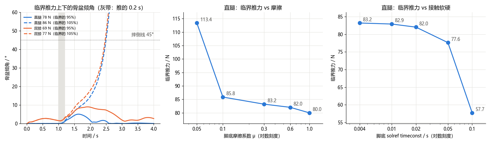

# 第 5 课　扛住多大的推力：从侧面推 G1

**对应入门教程**：5.6、8.2、8.3、8.4、8.6

**本课目标**

- 用 `xfrc_applied` 给躯干施加一段持续的外力，并且知道它作用在哪、什么时候要清零。
- 给“摔倒”下一个明确的判据，用二分搜索找出 G1 不摔倒的最大推力。
- 自己设计一个屈膝站姿（脚平放、质心在支撑区中心），和直腿站姿比一比谁更抗推。
- 改脚底的 `friction`、`solref`、`solimp`，看临界推力怎么变，弄懂这几个参数到底管什么。

**预计用时**：2–2.5 小时　**前置**：第 2 课（position 执行器、关键帧）、第 4 课（质心与支撑区域）

---

## 5.1 怎么“推”它：`xfrc_applied`

`d.xfrc_applied` 是一个 `nbody × 6` 的数组，每行对应一个 body：

```python
d.xfrc_applied[body_id] = [fx, fy, fz, tx, ty, tz]   # 世界坐标系下的力 (N) 和力矩 (N·m)
```

三件事要记住：

- **作用点是这个 body 的质心**（`d.xipos[body_id]`），方向按**世界坐标系**算，和 body 自己怎么转无关。
- **不会自动清零。** 写进去以后每一步都在推，直到你自己把它改回 0。
- 查看器里双击选中一个 body，再按住 `Ctrl` + 右键拖动推它，用的也是这个字段。所以在 `--view` 模式下，脚本只在“推完那一刻”清零一次，平时不去碰它，免得把你的鼠标扰动覆盖掉。

本课统一这样推（和第 2、4 课一样）：

| 项目 | 取值 |
|---|---|
| 推哪里 | 躯干 `torso_link` 的质心（站立时离地约 1.02 m） |
| 往哪推 | 世界 +y，也就是机器人的左侧 |
| 什么时候 | t = 1.0 s 起，持续 0.2 s，大小恒定为 F |
| 看多久 | 一直仿真到 t = 4.0 s |

```python
pushing = PUSH_T0 <= d.time < PUSH_T0 + PUSH_DUR
d.xfrc_applied[torso, :] = 0.0                  # 每步先清零
if pushing:
    d.xfrc_applied[torso, :3] = F * PUSH_DIR    # 再按需要写；PUSH_DIR = [0, 1, 0]，即 +y
mujoco.mj_step(m, d)
```

> 也可以用 `d.qfrc_applied` 直接给广义力（关节空间的力）。想“推某个点”时用 `xfrc_applied` 更直观；想给某个关节额外加力矩时用 `qfrc_applied`。

## 5.2 什么算“摔倒”，怎么找临界推力

### 摔倒的判据

“倒没倒”必须写成代码能判断的条件。本课用两条，任一条满足就算摔倒：

| 判据 | 阈值 | 理由 |
|---|---|---|
| 骨盆高度 `qpos[2]` | 低于 0.5 m | 站立时 0.79 m，倒地后只剩 0.1 m 左右，中间没有“半倒”的稳定状态 |
| 骨盆倾角 | 超过 45° | 骨盆竖直轴（旋转矩阵第 3 列）和世界 z 轴的夹角；倾到 45° 质心早已越出支撑区，回不来了 |

倾角的算法只要一行：骨盆旋转矩阵 `d.xmat[pelvis]` 按行展开，第 9 个数（下标 8）就是它的 z 轴在世界 z 方向上的分量，取 `arccos` 就是倾角。

为什么要两条？高度判据只在“已经躺下”时才触发；倾角判据能更早发现“正在倒”，还能抓住“往后坐倒但骨盆没降多少”的情况。

### 二分搜索

如果“推力越大越容易倒”成立（单调），就可以二分：

```text
lo = 0 N（站得住），hi = 300 N（推得倒）
重复：mid = (lo + hi) / 2，推一次
      倒了 → hi = mid；没倒 → lo = mid
直到 hi − lo < 0.5 N，lo 就是“不摔倒的最大推力”
```

每次约 10 轮，一轮就是一次 4 s 的仿真。G1 每步只要几十微秒，所以找一个临界推力只要两秒左右。

单调性不能想当然，脚本会先用笨办法验证一遍：从 40 N 到 200 N 每隔 4 N 推一次，打印一行 `.`（站住）和 `X`（摔倒）。如果出现 `..X..XX` 这种交错，说明存在“推得大反而不倒”的区间，二分的结果就不可信了。

## 5.3 设计一个屈膝站姿

`stand` 关键帧的腿全是 0，也就是直腿站。人被推的时候会下意识屈膝。我们也给 G1 设计一个屈膝站姿，要求是：**两脚平放在地上，质心落在支撑区中间**。

思路分三步，全部在 `crouch_pose()` 里：

1. **脚要平**。G1 腿上的 `hip_pitch`、`knee`、`ankle_pitch` 三个关节都绕 y 轴转，转轴互相平行（髋的 roll、yaw 都是 0）。这时脚相对骨盆的俯仰角就等于三个角之和。令 `ankle = -(hip + knee)`，三者之和为 0，脚就和骨盆一样“平”；骨盆保持竖直，脚掌就平贴地面。
2. **质心要正**。膝角固定为 1.0 rad（约 57°）。髋角 `hip` 越大，大腿越往后摆，脚相对骨盆就越靠后（骨盆和上身始终竖直），反过来看就是质心相对脚越靠前。于是用二分法求 `hip`，让整机质心 `subtree_com[0]` 的 x 正好落在 8 个脚底小球 x 坐标的平均值上，也就是支撑区的正中间。
3. **脚要踩地**。屈膝后骨盆高度要跟着降。用 `mj_kinematics` 算出脚底小球的高度，把骨盆的 `qpos[2]` 平移一下，让小球的高度和 `stand` 关键帧里完全一样。

```python
def place(hip):
    q = q_stand.copy()
    for side in ("left", "right"):
        q[m.joint(f"{side}_hip_pitch_joint").qposadr[0]] = hip
        q[m.joint(f"{side}_knee_joint").qposadr[0]] = knee
        q[m.joint(f"{side}_ankle_pitch_joint").qposadr[0]] = -(hip + knee)
    d.qpos[:] = q
    mujoco.mj_kinematics(m, d)
    q[2] += z_foot - d.geom_xpos[feet, 2].min()     # 调骨盆高度，让脚刚好踩地
    d.qpos[:] = q
    mujoco.mj_kinematics(m, d)
    mujoco.mj_comPos(m, d)                          # subtree_com 在这一步才算出来
    return q, d.subtree_com[0, 0] - d.geom_xpos[feet, 0].mean()
```

注意 `subtree_com` 不是 `mj_kinematics` 算的，要再调一次 `mj_comPos`（或者直接用 `mj_forward`）。

求出来的结果是 `hip_pitch = -0.464`、`ankle_pitch = -0.536` rad，骨盆从 0.790 m 降到 0.712 m。踝角在关节范围 [−0.873, 0.524] 内，不会顶到限位。仿真时 `ctrl` 直接设成这组关节角，位置伺服就会保持这个姿势。

## 5.4 运行脚本：直腿 vs 屈膝

### 先猜一猜

1. 恒定推 0.2 s，你觉得直腿站的 G1 能扛住多少牛？（提示：它重 33.3 kg，自身重力约 327 N。）
2. 屈膝站姿质心更低，你觉得它的临界推力比直腿高还是低？
3. 只推 0.2 s 和一直推着不撤，哪种需要的力更大？

### 运行

```bash
python code/05_push.py                              # 全部实验，约 1–1.5 分钟，结果写到 output/
python code/05_push.py --once --force 90            # 只推一次（几秒），截图和倾角曲线写到 output/05_once.png
python code/05_push.py --view --force 90            # 查看器里看直腿被推 90 N
python code/05_push.py --view --crouch --force 70   # 屈膝站姿被推 70 N
```

`--view` 模式每 4 s 自动重来一次，可以反复看。它用的是 `mujoco.viewer.launch_passive`（被动查看器），仿真循环在脚本里，查看器只负责显示和收鼠标事件。

<!-- lab {"title": "推一次：直腿还是屈膝", "script": "05_push.py", "run": ["--once"], "stream": true, "show": ["output/05_once.png"], "focus": "once", "note": "先按你在“先猜一猜”里猜的推力推一次，再上下调整推力，找出站住和摔倒的分界。勾上“再求临界推力”，脚本会用 5.2 节的二分法直接算出来。", "fields": [{"flag": "--force", "label": "推力", "unit": "N", "value": 90, "min": 0, "max": 300, "step": 1}, {"flag": "--crouch", "label": "屈膝站姿", "type": "check"}, {"flag": "--critical", "label": "再求临界推力（多 1–3 秒）", "type": "check", "onceOnly": true}]} -->

<!-- lab {"title": "跑完整的 A–D 组实验", "script": "05_push.py", "run": [], "focus": "critical_force", "note": "约 1–1.5 分钟。跑完对照下面“A 组结果”以及 5.5–5.7 节的表格。", "show": ["output/05_push.png", "output/05_push_results.csv"]} -->

### A 组结果

脚本先打印两种站姿的静态信息：

| 站姿 | 骨盆高 | 质心高 | 躯干质心高 h | 质心比支撑区中心 x 偏 | 不推时最大倾角 |
|---|---|---|---|---|---|
| 直腿 `stand` | 0.790 m | 0.692 m | 1.019 m | −3.2 cm | 0.1° |
| 屈膝 knee=1.0 | 0.712 m | 0.630 m | 0.941 m | 0.0 cm | 2.8° |

单调性检查（40–200 N，每 4 N 一格）：

```text
直腿 ...........XXXXXXXXXXXXXXXXXXXXXXXXXXXXXX
屈膝 .........XXXXXXXXXXXXXXXXXXXXXXXXXXXXXXXX
```

没有交错，可以放心二分。临界推力：

| 站姿 | 临界推力 | 两脚最大水平位移 |
|---|---|---|
| 直腿 `stand` | **82.0 N** | 5.9 cm |
| 屈膝 knee=1.0 | **72.9 N** | 5.7 cm |
| 直腿，kp×10 | 89.9 N | 2.1 cm |
| 屈膝，kp×10 | 91.7 N | 2.3 cm |

（“两脚最大水平位移”是用临界推力推时，两只脚的 site 在 4 s 内离开原位的最大水平距离。）



左图是用临界推力的 95% 和 105% 各推一次的骨盆倾角。95% 时倾角最多涨到 5–9° 就回来了；105% 时倾角一路涨，过了 45° 摔倒线。推完的那一刻两条曲线还几乎重合，要再过零点几秒才分开，真正越过 45° 已经是 t ≈ 2.5 s 了。翻倒是一个慢过程：推力只是给了它一个初速度，之后能不能“翻过去”，看的是重力能不能把它拉回来。

### 怎么理解这几个数

**静力学估计。** 往 +y 推，G1 会绕左脚外侧边缘翻倒。把它看成一块刚体，力矩平衡就是

$$F\cdot h = M g\cdot w$$

w 是质心到翻倒支点的水平距离。支点是左脚最外侧那排小球的接地点：小球和地面的接触点在球心正下方，所以只看球心的 y，不用加半径。h 是推力作用点（躯干质心）的高度。脚本算出 w = 14.84 cm，直腿时 $F = 47.7$ N，屈膝时 $F = 51.6$ N。这是“一直推着不撤”时刚好推倒刚体的力。

- 只推 0.2 s 时，临界推力 82.0 N 比 47.7 N 大得多：短时间的推力超过静力学值也不一定倒，要看这一下给的**冲量**（82.0 × 0.2 ≈ 16.4 N·s）够不够把质心送过脚的边缘。
- 按刚体的想法，屈膝时 h 更小，应该更抗推。可实际上屈膝的临界推力反而低了 9 N。

**为什么屈膝反而差？** 关键在“位置伺服不是刚体”。position 执行器就是一个 kp=500 的弹簧，受力就会偏离目标角。直腿时重力几乎沿着腿骨传下去，关节不怎么受力；屈膝时膝、髋、踝都要扛重力矩，本身就“软”在那里（不推时骨盆已经倾了 2.8°），被侧推时腿还会额外弯、扭，质心被带得更偏。

证据就在表格最后两行：把所有关节的 kp 乘 10（kv 乘 $\sqrt{10}$，保持临界阻尼），腿接近刚体，屈膝立刻反超直腿（91.7 N 对 89.9 N），和刚体的直觉一致了。

> 人屈膝抗推，靠的是主动调整（踝、髋策略，甚至迈步），不是姿势本身。G1 现在只是“把关节锁在一个角度上”，没有任何平衡控制，屈膝只会多出柔性。第 8 课会给它加上真正的平衡控制器。

## 5.5 摩擦：`friction` 和 `priority`

### 参数含义（入门教程 8.2）

geom 的 `friction` 有 3 个数：`滑动 扭转 滚动`，默认 `1 0.005 0.0001`。用到几个由 `condim` 决定：G1 脚底小球是 `condim="3"`，只有法向力和两个方向的滑动摩擦，后两个数不起作用。

两个 geom 接触时，摩擦系数取谁的？

- `priority` 高的一方说了算；
- 优先级相同，就逐元素取**最大值**。

G1 的脚底小球写着 `priority="1" friction="0.6"`，地面是默认的 `priority="0" friction="1"`。所以脚和地面的接触用的是 **0.6**，地面的摩擦根本不起作用。

### 先猜一猜

1. 只把地面 `floor` 的摩擦改成 0.1，临界推力会变吗？
2. 把脚底的摩擦从 0.6 改成 0.05（像冰面），G1 是更容易倒，还是更不容易倒？

<!-- lab {"title": "在冰面上推它", "script": "05_push.py", "run": ["--once"], "stream": true, "show": ["output/05_once.png"], "focus": "once", "note": "脚底 μ = 0.05 时，用默认摩擦下必倒的 100 N 推一下。看截图里它是倒了还是滑走了，再把 μ 调回 0.6 对比。", "fields": [{"flag": "--force", "label": "推力", "unit": "N", "value": 100, "min": 0, "max": 300, "step": 1}, {"flag": "--mu", "label": "脚底 μ", "value": 0.05, "min": 0.01, "max": 2, "step": 0.01}, {"flag": "--crouch", "label": "屈膝站姿", "type": "check"}, {"flag": "--critical", "label": "再求临界推力（多 1–3 秒）", "type": "check", "onceOnly": true}]} -->

### B 组结果（直腿站姿）

脚本直接改编译好的模型：`m.geom_friction[脚底小球, 0] = μ`。这类数值参数改了就生效，不用重新编译。

| 设置 | 临界推力 | 两脚最大水平位移 | 静止穿透 |
|---|---|---|---|
| 脚底 μ = 0.05 | **113.4 N** | **44.2 cm** | 0.00 mm |
| 脚底 μ = 0.1 | 85.8 N | 7.1 cm | 0.01 mm |
| 脚底 μ = 0.3 | 83.2 N | 5.9 cm | 0.07 mm |
| 脚底 μ = 0.6（默认） | 82.0 N | 5.9 cm | 0.29 mm |
| 脚底 μ = 1.0 | 80.0 N | 6.0 cm | 0.71 mm |
| 只把地面 μ 改成 0.1 | 82.0 N | 5.9 cm | 0.29 mm |

几点观察：

- **只改地面，什么都没变**，和默认一模一样。原因就是上面的 `priority`。想改“地面滑不滑”，在这个模型里要改脚，或者把地面的 priority 调得比脚高。
- **摩擦越小，临界推力反而越大。** μ = 0.05 时它没倒，而是整个人被推着滑出去 44 cm。滑动把推力的一部分能量用摩擦耗掉了，翻倒的力矩也小了（脚底摩擦力就是让它绕脚边转的那个支点力）。但在真实世界里，滑出去半米同样是事故。判据只看“倒没倒”，所以表格要和位移一起看。
- 默认 μ 下脚也挪了 5.9 cm。这主要是右脚（迎着推力那一侧）：被推的时候它几乎被卸载，接触力很小，摩擦力也就很小，被腿拖着往里滑。
- **静止穿透也随 μ 变**，这有点反直觉。原因是默认的摩擦锥是棱锥型（`cone="pyramidal"`）：它把法向力和摩擦力绑在一起，拆成几个沿“棱”方向的约束来求解，摩擦系数会影响法向的等效软硬。换成椭圆锥 `cone="elliptic"` 后，法向和摩擦分开处理，就没有这个现象了（见练习 4）。

## 5.6 接触有多软：`solref` 和 `solimp`

### 参数含义（入门教程 8.3）

MuJoCo 的接触是**软约束**：允许脚稍微压进地面，压得越深，推回来的力越大。“有多软”由两组参数决定：

| 参数 | 默认值 | 管什么 |
|---|---|---|
| `solref="timeconst dampratio"` | `0.02 1` | 把接触看成弹簧-阻尼器。timeconst 是“消除穿透需要多长时间”，越小越硬；dampratio=1 是临界阻尼，小于 1 会弹 |
| `solimp="d0 dw width midpoint power"` | `0.9 0.95 0.001 0.5 2` | 阻抗 d，取值 0 到 1，表示约束“能使出几成力”。穿透为 0 时是 d0，穿透达到 width（米）时是 dw，中间按 midpoint、power 决定的 S 形曲线过渡。d 越接近 1 越硬 |

官方文档给了一个静止时穿透深度的公式（正数格式、阻抗为常数 d 时）：

$$r = a_u\,(1-d)\,\text{timeconst}^2\,\text{dampratio}^2$$

$a_u$ 是没有约束时的加速度（这里差不多就是重力加速度）。可以看出：timeconst 翻倍，穿透变成 4 倍；d 从 0.9 降到 0.5，$(1-d)$ 变成 5 倍。

两个 geom 的 solref / solimp 怎么合成？规则和摩擦类似：`priority` 高的一方说了算；优先级相同时按 `solmix` 加权平均。G1 的脚 priority 更高，所以改脚就够了。

另外，timeconst 至少要是时间步长的 2 倍（这里是 0.004 s），更小的值会被 MuJoCo 自动抬到这个下限。

### C 组结果（直腿站姿，只改脚底小球）

| 设置 | 临界推力 | 两脚最大水平位移 | 静止穿透 |
|---|---|---|---|
| solref timeconst = 0.004 | 83.2 N | 5.6 cm | 0.01 mm |
| solref timeconst = 0.01 | 82.9 N | 5.7 cm | 0.08 mm |
| solref timeconst = 0.02（默认） | 82.0 N | 5.9 cm | 0.29 mm |
| solref timeconst = 0.05 | 77.6 N | 6.1 cm | 0.94 mm |
| solref timeconst = 0.1 | **57.7 N** | 3.9 cm | **4.29 mm** |
| solimp = 0.99 0.99 0.001 | 82.6 N | 5.6 cm | 0.03 mm |
| solimp = 0.5 0.95 0.001 | 82.0 N | 6.0 cm | 0.64 mm |
| solimp = 0.9 0.95 0.01 | 82.0 N | 6.1 cm | 0.33 mm |
| solimp = 0.5 0.6 0.01 | **72.9 N** | 7.9 cm | 2.21 mm |

- **默认值附近，临界推力几乎不变**（82–83 N）。接触已经够硬，再硬也没用。
- **接触软到一定程度，临界推力明显下降。** timeconst = 0.1 时脚压进地面 4 mm 多，推一下，外侧的脚边压得更深，相当于脚底下垫了一层海绵，人更容易歪过去。
- `solimp = 0.5 0.95 0.001` 的 d0 虽然小，但 width 只有 1 mm，稍一压就涨到 0.95，所以临界推力没变。只有 d0、dw 都小、width 又大（`0.5 0.6 0.01`）时，整段都是软的，临界推力才掉下来。

<!-- lab {"title": "把脚底变软", "script": "05_push.py", "run": ["--once"], "stream": true, "show": ["output/05_once.png"], "focus": "once", "note": "timeconst = 0.1 时，默认能扛住的 70 N 还扛得住吗？改回 0.02 再推一次对比。", "fields": [{"flag": "--force", "label": "推力", "unit": "N", "value": 70, "min": 0, "max": 300, "step": 1}, {"flag": "--timeconst", "label": "脚底 solref timeconst", "unit": "s", "value": 0.1, "min": 0.004, "max": 0.5, "step": 0.002}, {"flag": "--critical", "label": "再求临界推力（多 1–3 秒）", "type": "check", "onceOnly": true}]} -->

> 实用结论：仿真里的“地面”默认就够硬。调 solref / solimp 通常是为了**模拟软地面**（草地、垫子）或者**解决穿透、抖动**，不是为了让机器人更稳。

## 5.7 数值设置会不会改变结论

（入门教程 8.4、8.6）结论如果随时间步长、积分器变来变去，那测的就是数值误差，不是物理。D 组把三项数值设置各改一下：

| 设置 | 直腿临界推力 | 屈膝临界推力 |
|---|---|---|
| 默认（timestep 0.002、implicitfast、pyramidal） | 82.0 N | 72.9 N |
| timestep = 0.001 | 81.7 N | 72.9 N |
| integrator = Euler | 82.3 N | 73.2 N |
| cone = elliptic | 79.7 N | 67.7 N |

- 时间步长减半、换积分器，临界推力变化不到 0.5 N，和二分精度（0.5 N）相当。说明 2 ms 步长对这个实验已经收敛。
- 换摩擦锥变化大一些（屈膝少了 5 N）。棱锥和椭圆是两种**不同的摩擦模型**，不是同一个模型的不同精度，所以结果有差别是正常的。椭圆锥更接近真实的库仑摩擦。
- 无论哪种设置，“直腿比屈膝更抗推”的结论都不变。这才是可以写进报告的结论。

8.6 的稳定性清单在这里的体现：G1 的模型已经用了 `implicitfast`，每个关节都有 `armature="0.01"`，所以默认设置下就很稳。你自己的模型如果在被推时发散、乱飞，按清单先减小 timestep，再换 `implicitfast`，再查 armature。

## 观察记录

1. 对照“先猜一猜”，直腿站姿的临界推力你猜的是多少？实际是多少？
2. 屈膝站姿为什么不如直腿？kp×10 那两行说明了什么？
3. 只改地面摩擦为什么没有效果？如果要让“地面”说了算，模型该怎么改？
4. μ = 0.05 时临界推力最大。能说“摩擦越小机器人越稳”吗？
5. 把 solref 的 timeconst 从 0.02 改到 0.1，穿透深度变成几倍？和公式 $r \propto \text{timeconst}^2$ 的预测（25 倍）比，接近吗？

## 练习

1. **推多久。** 把 `PUSH_DUR` 改成 0.1、0.4、1.0 s，只求直腿站姿的临界推力。临界推力和冲量 $F\cdot\Delta t$ 分别怎么变？推 1.0 s 时的临界推力和静力学估计 47.7 N 比，哪个大？为什么？

   提示：脚本名以数字开头，不能直接 `import`，可以这样加载后改常量：

   ```python
   import importlib.util
   spec = importlib.util.spec_from_file_location("push", "code/05_push.py")
   p = importlib.util.module_from_spec(spec); spec.loader.exec_module(p)
   m = p.load_model(); q = p.stand_pose(m)
   p.PUSH_DUR = 0.1
   print(p.critical_force(m, q)[0])
   ```

   不写代码也行：`python code/05_push.py --once --dur 0.1 --critical` 做的是同一件事，见本节末尾的实验台。

2. **推哪里。** 把 `PUSH_BODY` 改成 `"pelvis"`（骨盆质心约 0.71 m 高），临界推力变成多少？用 $F\cdot h$ 的思路解释。
3. **屈多少。** 用 `crouch_pose(m, knee)` 试 knee = 0.5 和 1.2，记录髋角、踝角、骨盆高度和临界推力。屈得越深越好还是越差？
4. **摩擦锥与穿透。** 把 `m.opt.cone` 设成 `mujoco.mjtCone.mjCONE_ELLIPTIC`，再扫一遍脚底 μ = 0.05、0.1、0.6、1.0，用 `penetration_mm()` 看静止穿透还随 μ 变吗？
5. **（选做）往前推、往后推。** 用练习 1 的加载方法，把 `p.PUSH_DIR` 改成 `np.array([1.0, 0, 0])`（向前）和 `np.array([-1.0, 0, 0])`（向后），临界推力各是多少？结合第 4 课的支撑区域，解释为什么和侧推不一样。再把 kp 乘 10（做法见脚本 `part_a()`）试一次往前推，结果说明了什么？

<!-- lab {"title": "练习 1：推多久", "script": "05_push.py", "run": ["--once"], "stream": true, "show": ["output/05_once.png"], "focus": "once", "note": "改“推多久”，勾着“再求临界推力”运行，把每个时长的临界推力和冲量 $F\\cdot\\Delta t$ 记下来。", "fields": [{"flag": "--force", "label": "推力", "unit": "N", "value": 60, "min": 0, "max": 300, "step": 1}, {"flag": "--dur", "label": "推多久", "unit": "s", "value": 0.1, "min": 0.01, "max": 3, "step": 0.05}, {"flag": "--crouch", "label": "屈膝站姿", "type": "check"}, {"flag": "--critical", "label": "再求临界推力（多 1–3 秒）", "type": "check", "onceOnly": true, "checked": true}]} -->

## 如果报错

| 现象 | 可能原因 | 解决 |
|---|---|---|
| 推完以后机器人一直往一边飘 | 忘了把 `xfrc_applied` 清零 | 每步先写 0，或者推完时清零一次 |
| 推力加到很大也推不倒 | 写错了下标：`xfrc_applied[id, 1]` 是 fy，`[id, 4]` 是绕 y 的力矩 | 前 3 个是力，后 3 个是力矩 |
| 二分结果每次差很多、或比扫描结果大 | 摔倒与否不单调（例如屈膝太深时往后坐倒） | 先跑单调性检查；不单调就缩小搜索区间或换判据 |
| 改了地面 friction 没效果 | 脚的 `priority="1"` 更高，接触用脚的参数 | 改脚底小球，或把地面 priority 设得更高 |
| 改 solref 的 timeconst 小于 0.004 也没变化 | 低于 2 倍时间步长的值会被自动抬高 | 想更硬就先减小 `timestep` |
| 屈膝姿势一开始就往后倒 | 自己凑的髋角、踝角让质心落到了支撑区外，或者脚没放平 | 按 5.3 的方法：踝角取 `-(hip + knee)`，髋角用二分法让质心对准脚的中间 |
| `--view` 窗口打不开或报 OpenGL 错误 | 远程桌面、虚拟机显卡不支持 | 先不加 `--view` 跑无界面版本；或参考第 1 课改用网页查看器 |
| `AttributeError: module 'mujoco' has no attribute 'viewer'` | 没有 `import mujoco.viewer` | 脚本里 `view()` 已经单独导入；自己写时别漏 |

## 延伸阅读

- [仿真：辅助控制 qfrc_applied 与 xfrc_applied](../官方文档_中文HTML/programming/simulation.html#siinput)
- [建模：接触参数怎么合成（priority、solmix）](../官方文档_中文HTML/modeling.html#ccontact)、[solref / solimp 的混合规则](../官方文档_中文HTML/modeling.html#solmixing)
- [建模：求解器参数 solimp（阻抗）](../官方文档_中文HTML/modeling.html#csolverimpedance)、[solref（参考加速度）](../官方文档_中文HTML/modeling.html#csolverreference)、[摩擦约束](../官方文档_中文HTML/modeling.html#csolverfriction)、[缓慢滑移](../官方文档_中文HTML/modeling.html#cslowslippage)
- [XML 参考：geom 的 friction](../官方文档_中文HTML/XMLreference.html#body-geom-friction)、[priority](../官方文档_中文HTML/XMLreference.html#body-geom-priority)、[condim](../官方文档_中文HTML/XMLreference.html#body-geom-condim)、[solref](../官方文档_中文HTML/XMLreference.html#body-geom-solref)、[solimp](../官方文档_中文HTML/XMLreference.html#body-geom-solimp)
- [XML 参考：option 的 timestep](../官方文档_中文HTML/XMLreference.html#option-timestep)、[integrator](../官方文档_中文HTML/XMLreference.html#option-integrator)、[cone](../官方文档_中文HTML/XMLreference.html#option-cone)
- [计算：接触与摩擦锥](../官方文档_中文HTML/computation/index.html#cocontact)
- [Python：被动查看器 launch_passive](../官方文档_中文HTML/python.html#pyviewerpassive)

---

<details>
<summary><b>参考答案（跑完再看）</b></summary>

**5.4 先猜一猜**：直腿推 0.2 s 的临界推力是 82.0 N，约为自重的四分之一。屈膝反而更低，72.9 N。只推 0.2 s 需要的力更大。一直推着时，刚体的静力学估计是 47.7 N；实际上推 1.0 s，G1 只要 35.2 N 就倒了（见练习 1）。

**5.5 先猜一猜**：只改地面摩擦，临界推力还是 82.0 N，完全不变。脚底 μ = 0.05 时更“不容易倒”（113.4 N），但会被推着滑出去 44.2 cm。

**观察记录 2**：屈膝时关节要扛重力矩，位置伺服本身就有偏差（不推时骨盆已倾 2.8°），被推时腿还会继续弯、扭，柔性让质心偏得更多。kp×10 后腿接近刚体，屈膝（91.7 N）超过直腿（89.9 N），说明“质心低更稳”在刚体意义上成立，G1 屈膝变差是伺服太软造成的。

**观察记录 3**：脚底小球 `priority="1"` 高于地面的 0，接触的 friction、solref、solimp 都只用脚的。想让地面说了算，把地面的 priority 设成 2 之类更高的值；或者用 `<contact><pair>` 显式指定这对 geom 的接触参数。

**观察记录 4**：不能。μ 小时它不倒，是因为在滑。滑出 44 cm 对真机同样是失败。判据要结合任务，例如再加一条“脚滑动超过 10 cm 也算失败”。

**观察记录 5**：0.29 mm → 4.29 mm，约 15 倍，比 25 倍小，但量级对得上。公式假设阻抗 d 是常数，而 solimp 默认的 d 会随穿透从 0.9 涨到 0.95（width = 1 mm）：穿透 0.29 mm 时 d 还在两者之间，穿透 4 mm 时已经到 0.95，$(1-d)$ 变小，把倍数拉低了。另外 5.5 节说过，棱锥摩擦锥也会影响法向的等效软硬，公式没有考虑这一点。

**练习 1**：

| 推多久 | 临界推力 | 冲量 F·Δt |
|---|---|---|
| 0.1 s | 148.5 N | 14.85 N·s |
| 0.2 s | 82.0 N | 16.41 N·s |
| 0.4 s | 50.4 N | 20.16 N·s |
| 1.0 s | 35.2 N | 35.16 N·s |

推得越短，越接近“只看冲量”（0.1 s 和 0.2 s 的冲量差不多）；推得越长，越接近“只看力”。推 1.0 s 时的 35.2 N 比静力学估计 47.7 N 还小，原因有二：一是腿不是刚体，侧推时髋、踝的伺服会让一点，质心被带向外侧，w 变小；二是力是突然加上去的，系统会冲过头（阶跃响应的超调），最大偏转比同样大小的静态力更大。

**练习 2**：推骨盆时临界推力是 104.0 N。骨盆质心比躯干质心低约 0.3 m，同样的力产生的翻倒力矩 $F\cdot h$ 小，所以要更大的力。

**练习 3**：

| knee | hip_pitch | ankle_pitch | 骨盆高 | 临界推力 |
|---|---|---|---|---|
| 0.5 | −0.203 | −0.297 | 0.770 m | 78.8 N |
| 1.0 | −0.464 | −0.536 | 0.712 m | 72.9 N |
| 1.2 | −0.567 | −0.633 | 0.679 m | 65.6 N |

屈得越深，临界推力越低，原因同观察记录 2。

**练习 4**：椭圆锥下，四种 μ 的静止穿透都是 0.713 mm，不再随 μ 变；棱锥锥下分别是 0.002、0.007、0.294、0.714 mm。椭圆锥把法向和摩擦分开处理，法向的软硬只由 solref、solimp 决定。

**练习 5**：往前推（+x）临界推力 29.0 N，往后推（−x）只有 22.6 N，都远小于侧推的 82.0 N。直腿站姿下，质心到脚尖那排小球 11.7 cm，到脚跟那排只有 5.3 cm（侧向是 14.8 cm），所以往后推最弱。按 $F = Mgw/h$ 的静力学估计，往前推是 $327 \times 0.117 / 1.019 \approx 37.5$ N，往后推约 17.1 N。往后推的 22.6 N 比静力学值大，和侧推一样，是“只推 0.2 s”带来的余量；往前推的 29.0 N 却连静力学值都不到。前后方向上，身体主要靠两个踝关节的 pitch 伺服“撑”在脚上，伺服一让，质心就往前送，w 被吃掉一截。把 kp 乘 10 再推，往前推升到 36.9 N，往后推升到 27.5 N，说明前后方向的短板主要来自伺服的柔性。这也是为什么真实的人形机器人前后方向更需要主动平衡（踝策略、迈步）。

</details>
