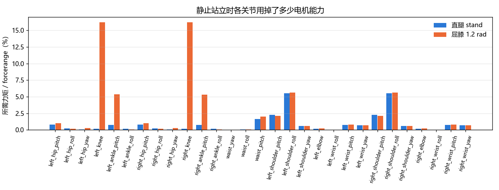
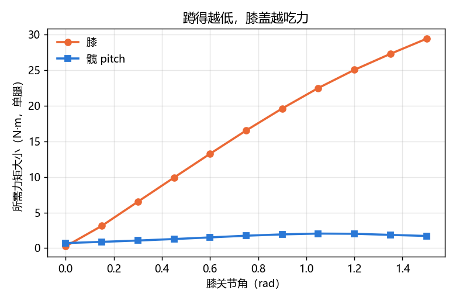
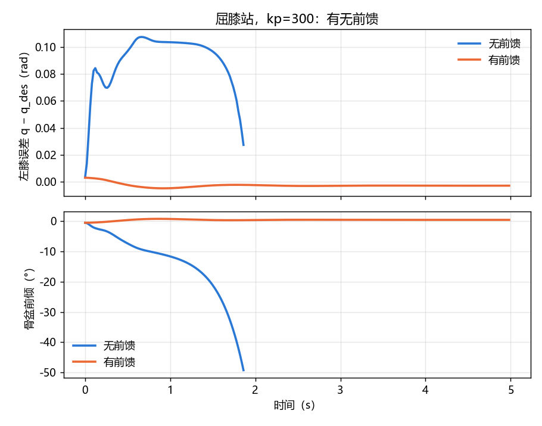

# 第 6 课　省力地站：算出“刚好站住”需要的力矩

**对应入门教程**：9.2、7.3

**本课目标**

- 用逆动力学 `mj_inverse` 算出 G1 静止站立时，每个关节到底要出多少力矩。
- 搞清楚浮动基机器人的特殊之处：`qfrc_inverse` 的前 6 维没有电机，只能靠地面接触力来提供。
- 把所需力矩和电机上限 `forcerange` 对比，算出余量；比较直腿站和屈膝站的膝盖负担。
- 用算出的力矩做**前馈**，配合较小的 kp，看稳态误差和所需增益怎么变。
- 认识质量矩阵 `mj_fullM`，并用它解释 `dampratio` 算出的 kv。

**预计用时**：2–2.5 小时　**前置**：第 2 课（position 执行器的力公式）、第 4 课（接触力）、第 5 课（屈膝站姿）

---

## 6.1 问题：站着不动，电机在出多少力？

第 2 课讲过，position 执行器的力是

$$\tau = k_p\,(\text{ctrl} - q) - k_v\,\dot q$$

静止时 $\dot q = 0$。如果关节需要力矩 $\tau$ 才能扛住重力，伺服就只能靠**误差**把它“攒”出来：

$$q - \text{ctrl} = -\tau / k_p$$

需要的力矩越大、kp 越小，误差就越大。想消掉这个误差，要么把 kp 调得很大，要么事先知道 $\tau$ 是多少，直接加进去。后一种做法叫**前馈**，而“事先知道 $\tau$”正是逆动力学的工作。

正向动力学和逆动力学是同一个方程的两种用法（入门教程 9.2）：

$$M(q)\,\ddot q + c(q,\dot q) = \tau + J^\mathsf{T} f$$

- **正向**（`mj_step`、`mj_forward`）：已知力 $\tau$，求加速度 $\ddot q$。
- **逆向**（`mj_inverse`）：已知 $q$、$\dot q$、$\ddot q$，求“需要施加的力”，结果放在 `d.qfrc_inverse`。

这里 $M$ 是质量矩阵，$c$ 是重力加科氏力（MuJoCo 里叫 `qfrc_bias`），$J^\mathsf{T} f$ 是接触等约束力。要“静止站住”，就令 $\dot q = 0$、$\ddot q = 0$。

### 先猜一猜

1. G1 用 `stand` 关键帧直腿站着时，膝盖电机需要多大力矩？（A）接近 0　（B）10 N·m 左右　（C）50 N·m 以上
2. 把接触关掉、让 G1 悬在空中，再做逆动力学。`qfrc_inverse[2]`（骨盆 z 方向）会是多少？
3. 屈膝 1.2 rad（约 69°）站着时，膝盖力矩大约占电机上限（139 N·m）的百分之几？
4. 屈膝站时，把所有关节的 kp 从 500 降到 200，不加前馈会怎样？加了前馈呢？

## 6.2 第一次调用 mj_inverse：浮动基的“前 6 维”

本课脚本是 `code/06_inverse.py`，默认无界面运行，大约 10 秒跑完：

```bash
python code/06_inverse.py
```

先看最核心的几行。脚本第 1 部分在 `stand` 姿势下，分三种情况调用 `mj_inverse`：

```python
mujoco.mj_resetDataKeyframe(m, d, KEY)        # qvel 是 0，qacc 也是 0
mujoco.mj_inverse(m, d)                       # (a) 直接用关键帧
print(d.qfrc_inverse[:6])

m.opt.disableflags |= mujoco.mjtDisableBit.mjDSBL_CONTACT   # (b) 关掉接触 = 悬空
mujoco.mj_inverse(m, d)

mujoco.mj_resetDataKeyframe(m, d, KEY)        # (c) 先仿真 3 秒，让它自己站稳
for _ in range(1500):
    mujoco.mj_step(m, d)
dd = mujoco.MjData(m)
dd.qpos[:] = d.qpos                           # 只拷位置，速度和加速度保持 0
mujoco.mj_inverse(m, dd)
```

> `mj_inverse` 的输入是 `qpos`、`qvel`、`qacc`，调用前要自己把 `qacc` 设好。新建的 `MjData` 里它们都是 0，正好是“静止”。如果给了非零的 `qacc`，结果里还会包含 $M\ddot q$ 这一项，也就是第 3 课挥手时剩下的那部分“加速度误差”也能一起算进前馈。本课只做静止站立，所以 `qacc` 始终是 0。

运行结果（节选）：

```text
MuJoCo 4.0.1，总质量 33.34 kg，重力 m·g = 327.08 N
(a) 直接用关键帧（骨盆 z=0.790，接触 8 个）：前 6 维 [    0.        0.    -5407.846     0.073   199.635     0.   ]
(b) 关掉接触（悬空）：前 6 维 [  0.      0.    327.077   0.027  -1.074   0.   ]
    左腿 6 个关节 [-1.219 -0.068  0.009 -0.256 -0.153  0.   ]
    与 qfrc_bias 的最大差 0.00e+00
(c) 先仿真 3 s 站稳（骨盆 z=0.7916，最大速度 1.3e-04，接触法向力合计 327.08 N）
    前 6 维 [ 0.     0.    -0.004 -0.    -0.001 -0.   ]
    左腿 6 个关节 [-0.713 -0.341  0.059  0.266  0.362  0.087]
```

### 前 6 维是什么

回忆第 1 课 1.5 的表：`qvel` 的前 6 个是骨盆 freejoint 的自由度，前 3 个是世界坐标系里的平移，后 3 个是绕骨盆自身坐标轴的转动。`qfrc_inverse` 和 `qvel` 一一对应，所以它的前 6 维就是“**为了让骨盆这样静止，需要有人直接对骨盆施加的力和力矩**”。

官方文档说得很明白：`qfrc_inverse` 等于**外力与执行器力之和**。G1 的 29 个电机全装在关节上，没有一个能直接推骨盆。所以：

- **前 6 维必须是 0**（或接近 0）。否则这个姿势在现实里不可能静止，得有一只看不见的手托着骨盆。
- **后 29 维**才是电机要出的力矩。

三种情况分别说明了一件事：

- **(b) 悬空**：前 6 维的 z 分量是 327.077 N，正好等于 m·g。没有地面，就得有人从上面把整台机器人提着。这时 `qfrc_inverse` 和 `qfrc_bias` 完全相同，因为没有加速度、没有接触，要抵消的只有重力。
- **(a) 直接用关键帧**：z 分量是 −5407.846 N，要“往下按”五千多牛！原因是关键帧里骨盆高 0.790 m，而站稳后是 0.7916 m，脚底小球陷进地面约 1.6 mm。MuJoCo 的接触是软约束，逆动力学根据穿透深度算接触力，陷得越深，地面推得越狠。
- **(c) 先站稳再算**：前 6 维几乎全是 0，接触法向力合计 327.08 N，正好托住整机重量。这才是有意义的结果。

> **要点**：对浮动基机器人做逆动力学，必须先让它和地面处于**真实的接触平衡**。最简单的办法是先仿真一段时间让它站稳，再拿那一刻的 `qpos`。

### 和入门教程 7.3 的对比

入门教程 7.3 的机械臂用 `qfrc_bias` 做重力补偿，第 3 课把 G1 吊起来时也是这么做的。但看 (b) 和 (c) 的左腿：悬空时膝盖要 −0.256 N·m（托着下垂的小腿），站在地上时却是 +0.266 N·m，**连符号都反了**。站着的时候，脚下的地面也在出力，`qfrc_bias` 不知道这一点。所以对站立的人形机器人，“重力补偿”要用带接触的逆动力学来算，不能照搬 `qfrc_bias[6:]`。

### 动手观察

1. 在 (c) 里，左腿 6 个关节最大的力矩是多少？在哪个关节？
2. 打开脚本，把 (c) 的仿真步数从 1500 改成 10（只站 0.02 秒），再看前 6 维。为什么变大了？
3. 骨盆前 6 维里，(a) 的第 5 个数（绕 y 轴的力矩）是 199.635。猜一猜它是怎么来的。（提示：8 个脚底球陷进地面的深度一样吗？）

## 6.3 逆动力学算得对吗

脚本接着做了三项检查：

```text
    验证 qfrc_inverse = qfrc_bias − qfrc_passive − qfrc_constraint：最大差 0.00e+00
    逆动力学 vs 伺服实际输出 actuator_force：最大差 0.177 N·m（在 right_hip_roll）
    左脚受到的侧向接触力：仿真中 -0.256 N，逆动力学中 +0.000 N
    把它作为 qfrc_applied 加回去、关掉执行器做 mj_forward：|qacc| 最大 0.00e+00
```

- **公式检查**：$\ddot q = 0$ 时，运动方程变成 $\tau = c - J^\mathsf{T}f$（再减去被动力）。MuJoCo 把这三项分别存在 `qfrc_bias`、`qfrc_constraint`、`qfrc_passive` 里，组合起来和 `qfrc_inverse` 完全一致。
- **加回去检查**：和入门教程 9.2 的做法一样，用 `mjDSBL_ACTUATION` 关掉执行器，把 `qfrc_inverse` 原样放进 `qfrc_applied`，再做 `mj_forward`，加速度是 0。说明这组力确实能让机器人静止。
- **和伺服实际输出比**：站稳时 position 伺服真正输出的力矩 `actuator_force`，和逆动力学最多差 0.177 N·m，出现在髋 roll。差在哪？看下一行：仿真里两只脚在侧向互相“较劲”，地面给左脚一个 −0.256 N 的侧向力（指向身体中线）；逆动力学里速度、加速度都是 0，脚在切向既没有滑动速度、也没有位移，软接触算出的摩擦力就是 0。

这就引出双脚站立的一个本质问题：**双脚支撑是超静定的**。体重怎么分给左右脚、脚尖和脚跟，两只脚之间要不要互相挤一挤，有无穷多种分法都能让合力平衡。MuJoCo 的软接触按“谁陷得深谁多出力”给出其中一种分法。所以姿势差一点，逆动力学算出的关节力矩也会差一点。后面迭代算前馈时还会看到这一点。

## 6.4 余量：所需力矩和 forcerange 比一比

第 1 课说过，`forcerange` 是第 6 课的重要线索。现在就能算出每个电机在站立时用掉了多少能力：

$$\text{余量} = 1 - \frac{|\tau|}{\text{forcerange 上限}}$$

脚本第 2 部分还准备了一个**屈膝站姿**：在 `stand` 的基础上，膝关节弯 1.2 rad，髋 pitch 和踝 pitch 各分担 −0.6 rad，让大腿和小腿对称、上身保持直立。函数 `pose(bend)` 负责生成这个姿势，`place()` 把骨盆放到脚底刚好碰地的高度。

屈膝站的力矩不能像 6.2 那样一步算出，因为 kp=500 的伺服会让膝盖“塌”下去一点（误差 τ/kp），塌下去以后的姿势就不是我们要的了。脚本用了一个简单的迭代：站稳 → 算逆动力学 → 把结果当前馈再站稳 → 再算：

```text
=== 2. 屈膝 1.2 rad 的站姿：先站稳，再迭代算前馈 ===
  第 1 轮：前馈=无，最大关节误差 0.0502 rad，左膝力矩 -25.02 N·m，骨盆残差 |前6维| 最大 0.336
  第 2 轮：前馈=有，最大关节误差 0.0087 rad，左膝力矩 -21.02 N·m，骨盆残差 |前6维| 最大 0.087
  第 3 轮：前馈=有，最大关节误差 0.0040 rad，左膝力矩 -22.54 N·m，骨盆残差 |前6维| 最大 0.030
```

- 第 1 轮没有前馈，最大误差 0.0502 rad，正好约等于 25.02 / 500 = 0.050。这就是 6.1 里的公式 $|q - \text{ctrl}| = |\tau| / k_p$。
- 加上前馈后误差降到 0.004 rad，骨盆残差也越来越接近 0。
- 膝盖力矩在 −21 到 −25 N·m 之间摆动，没有单调收敛，原因就是 6.3 讲的超静定：姿势稍有不同，体重在脚尖、脚跟之间的分配就变了。本课取第 3 轮的结果。

力矩的符号：膝关节正方向是弯曲。屈膝时重力想让它弯得更深，电机就得出**负**力矩往回撑。

各关节的结果（节选，完整的 29 行见运行输出和 `output/06_torque_margin.csv`）：

| 关节 | 上限 N·m | 直腿 τ | 余量 | 屈膝 1.2 τ | 余量 |
|---|---|---|---|---|---|
| left_hip_pitch | 88 | −0.71 | 99.2% | −0.90 | 99.0% |
| left_knee | 139 | +0.27 | 99.8% | −22.54 | 83.8% |
| left_ankle_pitch | 50 | +0.36 | 99.3% | +2.67 | 94.7% |
| waist_pitch | 50 | +0.83 | 98.3% | +1.00 | 98.0% |
| left_shoulder_roll | 25 | +1.38 | 94.5% | +1.40 | 94.4% |
| left_wrist_pitch | 5 | −0.04 | 99.3% | −0.04 | 99.2% |

```text
直腿：最吃力的关节 right_shoulder_roll（占上限 5.5%），29 个关节力矩平方和 6.9
屈膝：最吃力的关节 left_knee（占上限 16.2%），29 个关节力矩平方和 1036.9
```



几个值得注意的地方：

- **直腿站几乎不费力**。腿伸直时，重力的作用线差不多穿过髋、膝、踝的转轴，力臂接近 0，所以腿部关节都不到 1 N·m。全身最吃力的反而是肩 roll：`stand` 关键帧里手臂略微外张（肩 roll = ±0.2 rad），电机要托住整条手臂。
- **屈膝站，膝盖一下子成了主角**，占上限 16.2%。“力矩平方和”常被当作能耗的粗略指标，屈膝站是直腿站的 150 倍。
- 腿部电机上限是 88–139 N·m，静止站立只用了很小一部分。剩下的余量要留给走路、蹲起、抗推这些动态动作。

## 6.5 直腿与屈膝：蹲得越低越累

脚本第 4 部分把膝角从 0 扫到 1.5 rad，每个姿势都用 kp=500 的伺服站稳 3 秒，再做逆动力学（这里不迭代，用的是第 1 轮的结果）：

```text
    膝角     骨盆z   髋pitch        膝   踝pitch     膝占上限
  0.00   0.792    -0.72    +0.26    +0.36     0.2%
  0.30   0.784    -1.07    -6.52    +0.27     4.7%
  0.60   0.760    -1.51   -13.24    +0.07     9.5%
  0.90   0.722    -1.93   -19.60    -0.05    14.1%
  1.20   0.670    -2.02   -25.02    +0.32    18.0%
  1.50   0.607    -1.71   -29.38    +1.24    21.1%
```

（表中隔一行取一行，完整的见运行输出。）



膝盖力矩随屈膝角度几乎线性增长，髋 pitch 却一直只有 1–2 N·m。为什么？在这个对称的屈膝姿势里，上身直立，质心大致落在脚踝正上方。膝盖向前突出，它离“质心竖直线”的水平距离大约是小腿长 × sin(膝角 / 2)，膝角越大，这个力臂越长。髋关节则基本在质心正上方，力臂很小。练习 1 会让你用这个思路手算一遍。

> 还记得第 5 课吗？屈膝站反而不如直腿站抗推，原因是屈膝时关节本身就要扛重力矩，位置伺服“软”在那里。这张表把这份负担量化了：膝角 1.2 rad 时，每个膝盖一直要出 20 多 N·m。真实机器人上，这还意味着电机持续发热、更耗电。

## 6.6 质量矩阵 mj_fullM

运动方程里的 $M(q)$ 是**质量矩阵**（也叫关节空间惯性矩阵）。MuJoCo 内部只存稀疏格式（CSR，放在 `d.M` 里；老版本的 `d.qM` 从 3.11 起已经移除），想看完整的矩阵要用 `mj_fullM` 转成稠密格式：

```python
M = np.zeros((m.nv, m.nv))
mujoco.mj_fullM(m, d, M)      # 3.10 起参数顺序是 (m, d, dst)，老写法 (m, dst, d.qM) 已失效
```

> 调用前 `d` 里的位置相关量要是最新的（`mj_forward`、`mj_step` 或 `mj_inverse` 之后都可以）。

脚本第 5 部分的输出：

```text
形状 (35, 35)，非零元素 641 / 1225，对称误差 0.0e+00，特征值范围 [0.0102, 34.13]
左上 3×3（平移块）:
 [[33.341  0.     0.   ]
 [ 0.    33.341  0.   ]
 [ 0.     0.    33.341]]
左膝 M_ii = 0.1256，左腕 yaw M_ii = 0.0118（其中转子惯量 armature = 0.01）
```

怎么读这些数：

- **35 × 35**：大小是 `nv × nv`，对应 35 个速度坐标。
- **左上 3×3 是 33.341 × 单位阵**：沿 x、y、z 平移骨盆，整台机器人跟着一起平移，所以“惯量”就是总质量。
- **只有约一半元素非零**：左臂的关节转动不会带动左腿，它们之间的耦合项是 0。这是树形结构带来的稀疏性，MuJoCo 正是利用它来加速质量矩阵的分解和求解，关节越多省得越多。
- **对称、正定**：特征值全是正的。最小的 0.0102 来自手腕，几乎全是 `armature = 0.01` 贡献的。转子惯量让 $M$ 远离奇异，这也是第 1 课说“armature 能让仿真更稳定”的原因。

### 用 M 解释 dampratio 算出的 kv

第 1 课提到，`dampratio="1"` 会让 MuJoCo 自动给每个执行器算 kv。临界阻尼的公式是 $k_v = 2\sqrt{k_p \cdot m}$，那这里的“质量” $m$ 是哪个数？直接拿 $M_{ii}$ 试一试：

```text
关节                    模型kv  2√(kp·M_ii)  2√(kp/(M⁻¹)_ii)
left_hip_pitch      10.319       43.011           10.319
left_hip_roll       15.801       39.585           15.801
left_knee            9.080       15.847            9.080
left_ankle_pitch     4.924        5.055            4.924
waist_pitch          9.280       35.216            9.280
left_shoulder_yaw    7.347       10.119            7.347
29 个执行器里 |模型kv − 2√(kp/(M⁻¹)_ii)| 最大 2.8e-14
```

用 $M_{ii}$ 算出来的偏大；用 $1/(M^{-1})_{ii}$ 才完全对上（差 1e-14，只是浮点误差）。官方文档里写的等效质量就是 $(J M^{-1} J^\mathsf{T})^{-1}$，在 `qpos0` 处计算。

直观理解：$M_{ii}$ 是“其他关节全都锁死时”转动这个关节的惯量；$1/(M^{-1})_{ii}$ 是“其他关节都自由时”的等效惯量。G1 的骨盆是浮动的，髋电机一用力，腿往前转的同时，骨盆和上身也会往反方向转，所以感受到的惯量小得多：髋 pitch 的 kv 差了 4 倍多，换算成惯量差了约 17 倍（43.011 ÷ 10.319 再平方）。

## 6.7 前馈 + 小增益 PD

现在把算出的力矩用起来。控制律是

$$\tau = \tau_\text{ff} + k_p\,(q_\text{des} - q) - k_v\,\dot q$$

$\tau_\text{ff}$ 是逆动力学给的前馈。G1 的执行器是 position 类型，没有单独的力矩输入，但可以把前馈“折算”进目标角度里：

$$\text{ctrl} = q_\text{des} + \tau_\text{ff}/k_p$$

代入 position 的力公式：$k_p(\text{ctrl} - q) - k_v\dot q = \tau_\text{ff} + k_p(q_\text{des} - q) - k_v\dot q$，和上式完全一样。这样做的好处是，力矩仍然由执行器输出，仍然受 `forcerange` 限制，阻尼也仍然由隐式积分器处理，比在 Python 里自己算 PD 更稳定。

脚本用 MjSpec 生成不同 kp 的模型（kv 仍按 `dampratio=1` 自动算），并关掉 `ctrlrange` 限制，免得折算后的目标超出关节范围被截断：

```python
def make_model(kp):
    spec = mujoco.MjSpec.from_file(str(XML))
    for a in spec.actuators:
        a.set_to_position(kp=kp, dampratio=1.0)   # forcerange 保持不变
        a.ctrllimited = 0
    return spec.compile()

dd.ctrl[:] = q_des[7:] + tff / kp                 # 前馈折算成目标偏移
```

每组实验都从“kp=500 加前馈站稳”的状态出发，换成新的 kp，跑 5 秒。骨盆低于 0.45 m 算倒下。结果（`output/06_gain_sweep.csv`）：

| kp | 直腿·无前馈 | 直腿·有前馈 | 屈膝 1.2·无前馈 | 屈膝 1.2·有前馈 |
|---|---|---|---|---|
| 500 | 最大误差 0.0028 | 0.0001 | 膝 +0.0497，后仰 3.0° | 膝 −0.0013 |
| 400 | 0.0035 | 0.0001 | 膝 +0.0645，后仰 4.1° | 膝 −0.0017 |
| 300 | 0.0046 | 0.0003 | 1.88 s 倒下 | 膝 −0.0028 |
| 200 | 0.0068 | 0.0009 | 1.29 s 倒下 | 膝 −0.0080，前倾 1.3° |
| 150 | 0.0452，前倾 4.7° | 0.0127 | 1.15 s 倒下 | 膝 −0.0593，前倾 9.6° |
| 100 | 3.84 s 倒下 | 4.77 s 倒下 | 0.99 s 倒下 | 2.82 s 倒下 |
| 70 | 3.37 s 倒下 | 4.04 s 倒下 | 0.86 s 倒下 | 2.57 s 倒下 |
| 50 | 3.37 s 倒下 | 3.74 s 倒下 | 0.73 s 倒下 | 2.49 s 倒下 |

（误差单位都是 rad。直腿两列给的是 29 个关节里的最大误差。）



读这张表：

- **屈膝站，前馈的效果最明显。** 不加前馈，kp 至少要 400 才站得住，而且膝盖塌下去 0.05–0.065 rad，上身后仰。加了前馈，kp=200 就够了，误差 0.008 rad，比不加前馈、kp=500 时还小 6 倍。
- **不加前馈为什么会倒？** 看上图蓝线：kp=300 时膝盖塌下去约 0.1 rad，骨盆一路后仰，最后向后摔倒。膝盖一塌，姿势就变了，质心往后跑出了脚跟，伺服还在按原来的目标拉，回不来了。
- **加了前馈，kp 也不能无限小。** kp=150 时，屈膝站已经前倾 9.6°，还在慢慢漂；kp ≤ 100 全部倒下。直腿站更能说明问题：直腿时需要的力矩不到 1.4 N·m，前馈几乎没东西可补，可 kp=100 照样倒下。

最后一点是本课最重要的结论：**前馈只抵消“目标姿势下”的重力**。人形机器人站着就像一个倒立摆，身体一旦偏离目标，重力就会把它往更偏的方向拉，偏得越多拉得越狠，相当于一个“负刚度”。能和它对抗的只有 kp。

可以粗算一下。把整机看成绕脚踝转动的刚体，脚本第 6 部分开头打印了：

```text
倒立摆粗估：整机质心比踝 pitch 轴高 h = 0.641 m，负刚度 m·g·h = 210 N·m/rad；两个踝 pitch 并联，kp 至少要 105
```

身体前倾一个小角度 $\theta$，重力力矩约为 $m g h\,\theta$；两个踝 pitch 伺服能拉回来的力矩是 $2k_p\theta$。要拉得回来，就得 $2k_p > m g h$，即 kp 大于约 105。直腿实验里 kp=150 站住、kp=100 倒下，正好卡在这个数两边。实际上膝、髋也是“弹簧”，整条链比单个脚踝更软，所以这只是下限。所以：

- 前馈解决**稳态误差**：让机器人准确地停在目标姿势，不用靠大误差“攒”力矩。
- kp 解决**稳定性**：kp 必须大于倒立摆的负刚度，否则偏差会越滚越大。

真正的平衡控制器会去调整脚踝力矩、挪动质心来对抗这种不稳定，那是第 8 课（LQR）和第 9 课（学习到的行走策略）要做的事。

### 想在查看器里看

```bash
python code/06_inverse.py --view                  # 屈膝 1.2 rad，kp=200，有前馈
python code/06_inverse.py --view --noff           # 同样的 kp，去掉前馈：很快向后倒
python code/06_inverse.py --view --kp 120         # 有前馈但 kp 太小：慢慢往前倾，最后倒下
python code/06_inverse.py --view --bend 0.6       # 换个屈膝角度
```

脚本会先离线算好前馈（要几秒），再用 `mujoco.viewer.launch_passive` 打开窗口。窗口里可以像第 1 课那样，先双击选中躯干，再按住 `Ctrl` 用右键拖动推它一下，比较不同 kp 下的反应。

### 观察记录

1. 6.2 的 (a) 里骨盆 z 方向要 −5407.846 N，而 (c) 只差 1.6 mm，结果却接近 0。这说明逆动力学对什么特别敏感？
2. 屈膝 1.2 rad 时，膝盖用了上限的百分之几？直腿时最吃力的关节是哪个？
3. `dampratio` 算 kv 时用的是 $M_{ii}$ 还是 $1/(M^{-1})_{ii}$？为什么两者对髋关节差得特别多？
4. 屈膝站时，有前馈后 kp 最低能降到多少还站得住？那时误差比“无前馈、kp=500”大还是小？
5. 用一句话说明：前馈和 kp 各自负责什么？

## 6.8 小结

| 你想知道 | 用什么 |
|---|---|
| 保持某个状态需要多大的广义力 | 设好 `qpos`、`qvel`、`qacc`，调用 `mj_inverse`，读 `qfrc_inverse` |
| 浮动基能否静止 | 看 `qfrc_inverse[:6]` 是否接近 0；不为 0 就是需要“看不见的手” |
| 电机还剩多少余量 | `1 − |qfrc_inverse[6:]| / actuator_forcerange[:, 1]` |
| 质量矩阵 | `mj_fullM(m, d, M)`；等效惯量用 $1/(M^{-1})_{ii}$ |
| 给 position 伺服加前馈 | `ctrl = q_des + tau_ff / kp`（记得关掉 `ctrllimited`） |

## 练习

1. **手算膝盖力矩。** 屈膝时，假设质心在脚踝正上方，每个膝盖托着“膝盖以上的一半体重”，力臂约为小腿长 × sin(膝角 / 2)。用 `d.xanchor` 量出左膝到左踝 pitch 关节的距离，用 `m.body_mass` 求出单条小腿加脚的质量，估算膝角 1.2 rad 时的膝盖力矩，和 6.5 的表对比。
2. **双臂前平举。** 在 `stand` 的基础上，把两个 `shoulder_pitch` 改成 −1.57（手臂向前平举），两个 `elbow` 改成 0（伸直），用脚本里的 `settle_with_ff()` 算力矩。肩膀和腰的余量是多少？哪个关节最吃力？
3. **换个屈膝角度做增益扫描。** 把 6.7 的实验换成屈膝 0.6 rad，kp 取 300、200、150、100、70。有前馈和无前馈时，能站住的最小 kp 分别是多少？
4. **关键帧的高度。** 把 `stand` 关键帧的骨盆 z 依次改成 0.790、0.791、0.7916、0.792、0.793，各做一次 `mj_inverse`，记下接触数和 `qfrc_inverse[2]`。1 mm 的高度差对应多少牛顿？

## 如果报错

| 现象 | 可能原因 | 解决 |
|---|---|---|
| `qfrc_inverse[:6]` 是几千牛顿 | 直接用关键帧，脚陷进了地面；或者没站稳就算 | 先仿真一段时间，等速度接近 0 再取 `qpos` |
| `qfrc_inverse[2]` 正好是 327 N 左右 | 脚没碰到地（骨盆太高，或关掉了接触） | 检查 `d.ncon`；用 `place()` 把脚放到地面上 |
| `AttributeError: ... has no attribute 'qM'` 或 `TypeError: mj_fullM(): incompatible function arguments` | 用了老教程的写法 `mj_fullM(m, M, d.qM)`；新版本已移除 `d.qM` | 改成 `mj_fullM(m, d, M)`，`M` 要是 `(nv, nv)` 的 float64 连续数组 |
| 加了前馈反而抖或倒 | `ctrlrange` 把 `q_des + tau_ff/kp` 截断了；或前馈来自另一个姿势 | 设 `ctrllimited = 0`；前馈要在目标姿势附近算 |
| 自己在 Python 里写 PD（motor 执行器）时，kp、kd 稍大就发散 | 显式算出的阻尼力在 2 ms 步长下不稳定 | 用 position 执行器 + 折算前馈，阻尼交给隐式积分器；或减小 kd |
| `--view` 窗口打不开 | 远程桌面或虚拟机的图形驱动问题 | 先不加 `--view` 跑完看图；或改用 Studio 的 `--gfx=web` 观看模型 |
| 中文图例显示成方块 | matplotlib 找不到中文字体 | 脚本里已列了 Microsoft YaHei、SimHei、Noto Sans SC，装上其中一个即可 |

## 延伸阅读

- [计算：逆动力学与优化（为什么软接触才有逆动力学）](../官方文档_中文HTML/computation/index.html#moinverse)
- [计算：运动方程的总体框架](../官方文档_中文HTML/computation/index.html#framework)
- [计算：逆动力学的计算流程](../官方文档_中文HTML/computation/index.html#piinverse)
- [API：mj_inverse](../官方文档_中文HTML/APIreference/APIfunctions.html#mj-inverse)、[mj_fullM](../官方文档_中文HTML/APIreference/APIfunctions.html#mj-fullm)、[mj_contactForce](../官方文档_中文HTML/APIreference/APIfunctions.html#mj-contactforce)
- [XML 参考：position 执行器的 dampratio（等效质量的定义）](../官方文档_中文HTML/XMLreference.html#actuator-position-dampratio)
- [XML 参考：invdiscrete 标志（速度不为 0 时做逆动力学要注意）](../官方文档_中文HTML/XMLreference.html#option-flag-invdiscrete)
- [XML 参考：pid 执行器（自带前馈输入，可作为本课“折算前馈”的另一种做法）](../官方文档_中文HTML/XMLreference.html#actuator-pid)
- [XML 参考：joint 的 armature](../官方文档_中文HTML/XMLreference.html#body-joint-armature)
- [Python：被动式查看器 launch_passive](../官方文档_中文HTML/python.html#pyviewerpassive)

---

<details>
<summary><b>参考答案（跑完再看）</b></summary>

**6.1 先猜一猜**

1. （A）。直腿站时左膝只要 +0.27 N·m，腿部关节都不到 1 N·m。
2. 327.077 N，等于 m·g（33.34 kg × 9.81）。没有地面，就得有人把整台机器人提着。
3. 迭代后是 22.54 N·m，占 16.2%（余量 83.8%）；不迭代、膝盖塌下去一点时是 25.02 N·m，占 18.0%。
4. 不加前馈，1.29 s 时倒下；加了前馈能站住，膝误差 −0.0080 rad。

**6.2 动手观察**

1. 最大的是髋 pitch，−0.713 N·m。
2. 只站 10 步（0.02 秒）时，前 6 维的 z 分量是 −3800.399 N，最大速度还有 0.066。机器人刚开始从关键帧往上弹，脚仍陷在地面里，`qpos` 不是平衡状态，前 6 维就不会接近 0。
3. 8 个小球陷进地面的深度不一样，前后脚掌的接触力不对称，对骨盆形成一个绕 y 轴的力矩。

**观察记录**

1. 对接触的穿透深度特别敏感。软接触的逆动力学按穿透深度算接触力，毫米级的差别就能带来几千牛顿的变化（见练习 4）。
2. 屈膝 1.2 rad 时膝盖占上限 16.2%。直腿时最吃力的是肩 roll（1.38 N·m，占 5.5%）。
3. 用 $1/(M^{-1})_{ii}$。$M_{ii}$ 假设其他关节全锁死；G1 的骨盆是浮动的，髋一用力，骨盆和上身也会跟着反向转动，等效惯量小很多。髋 pitch 的 $M_{ii}$ 算出 kv = 43.011，实际 kv = 10.319。
4. kp=200。误差 −0.0080 rad，比无前馈、kp=500 时的 +0.0497 rad 小约 6 倍。kp=150 虽然没倒，但已前倾 9.6°，还在漂。
5. 前馈负责消除稳态误差（把重力力矩直接补上），kp 负责稳定性（对抗倒立摆的负刚度）。

**练习 1**：左膝到左踝 pitch 关节距离 0.300 m，单条小腿加脚（`left_knee_link`、`left_ankle_pitch_link`、`left_ankle_roll_link`）共 2.614 kg。每个膝盖托着 (33.34 − 2 × 2.614) / 2 ≈ 14.06 kg，约 137.9 N。力臂 0.300 × sin(0.6) ≈ 0.169 m，力矩 ≈ 23.4 N·m。仿真结果是 22.54（迭代后）到 25.02 N·m（不迭代），估算相当接近。

**练习 2**：迭代 3 轮后，左肩 pitch −4.66 N·m（余量 81.4%），腰 pitch −10.33 N·m（余量 79.3%），左踝 pitch +6.21 N·m（余量 87.6%），左膝 +6.00 N·m（余量 95.7%）。最吃力的是腰 pitch：两条手臂伸到前面，整个上身的重心前移，要靠腰往后拉住；脚踝和膝盖也跟着出力，把整机质心留在脚掌上方。

**练习 3**：屈膝 0.6 rad 时（前馈里左膝 −11.81 N·m）：

| kp | 无前馈 | 有前馈 |
|---|---|---|
| 300 | 站住，膝误差 +0.05，后仰 3.7° | 站住，膝误差 −0.0028 |
| 200 | 1.80 s 倒下 | 站住，膝误差 −0.0089 |
| 150 | 1.56 s 倒下 | 4.49 s 倒下 |
| 100 | 1.37 s 倒下 | 2.92 s 倒下 |
| 70 | 1.25 s 倒下 | 2.69 s 倒下 |

无前馈最小 kp=300，有前馈最小 kp=200。规律和屈膝 1.2 rad 一样：前馈能让 kp 再降一档，但降不到 150 以下。

**练习 4**：

| 骨盆 z（m） | 接触数 | `qfrc_inverse[2]`（N） |
|---|---|---|
| 0.790 | 8 | −5407.85 |
| 0.791 | 8 | −2225.61 |
| 0.7916 | 8 | −70.43 |
| 0.792 | 0 | 327.08 |
| 0.793 | 0 | 327.08 |

从 0.790 到 0.791，1 mm 差了约 3200 N。到 0.792 时脚已经离开地面，前 6 维变回 m·g。0.7916 也没有正好得到 0，因为站稳后各关节并不完全等于关键帧的角度，8 个小球的深度也不一样。这再次说明：要先仿真站稳，用真实的平衡姿势做逆动力学。

</details>
